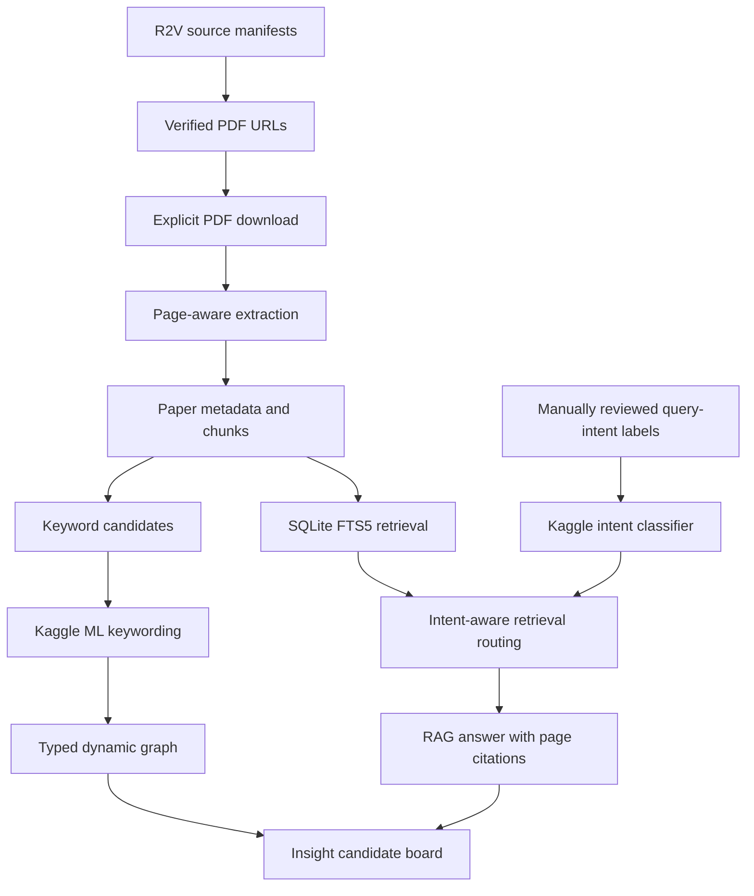
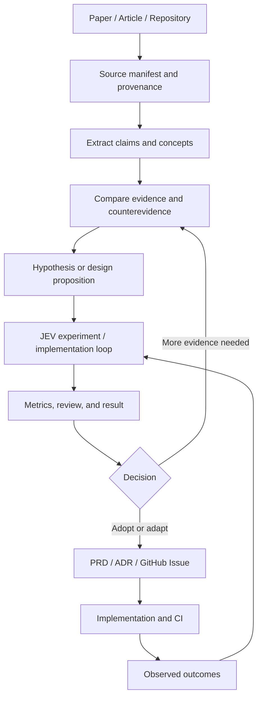

# PRD — Research & Engineering Knowledge Factory MVP

- Status: Draft
- Product: `bonsai/paper-digest`
- Related: [MRD](mrd-paper-explorer.md)
- Target corpus: a small, mixed source set of papers, engineering articles, official blogs, OSS repositories, and case studies; source access and usage terms must be verified
- Initial scope: AI software factory, agentic software engineering, GitHub automation, quality/evaluation loops, organizational learning, and human-AI collaboration; comics are optional outputs
- Runtime priority: Kaggle / local Python, free and reproducible

## 1. Product definition

Sources from a declared manifest are ingested into traceable records. PDFs use page-aware chunks; web articles use section/URL-level provenance; repositories use file/path/commit provenance where available. The user compares sources, asks evidence-grounded questions, and converts reviewed insights into PRDs, ADRs, Issues, experiment plans, and articles. Kaggle is an optional environment for reproducible keywording and classification experiments.

## 2. Source manifest and PDF acquisition

### Source of truth

- Seed metadata: `bonsai/r2v/papers.yaml`
- Explicit R2V RAG download records: `bonsai/r2v/rag/papers.yml`
- Mirror used by this project: `data/sources/r2v-papers.yaml`

Each record must contain:
- `id`, `title`, `source_url`, `pdf_url` (nullable until verified), `source_repository`, `arxiv_id` (nullable), `local_path`, `license_status`, `download_status`.
- Never commit PDFs or extracted full text by default.
- Download only when explicitly invoked.
- Verify HTTP status, content type, file signature, and nonzero file size before accepting a download.
- Keep a SHA-256 hash for every downloaded file.
- A paper source URL is not automatically a direct PDF URL.
- The current manifest contains 14 candidate records: 9 from R2V and 5 cross-domain additions. Candidate count is not the same as downloadable PDF count. Validate direct URLs, file signatures, and licenses/access before selecting the 10-PDF corpus. Show the corpus as incomplete until 10 valid PDFs are available.

## 3. MVP architecture

### Stack

- Python, PyMuPDF, pandas, NumPy
- Plotly for dynamic graph and diagnostics
- SQLite FTS5 as lexical RAG baseline
- scikit-learn for TF-IDF keyword baselines and optional query-intent classifier
- Kaggle Notebook for reproducible training/evaluation
- Optional embedding/LLM experiments only after a measured baseline

No paid API, GPU, or hosted vector database is required for the initial baseline.

## 4. User stories and acceptance criteria

### US-01 — Source discovery and PDF manifest

- Parse the mirrored R2V source manifest.
- Validate required metadata and direct PDF URLs.
- Preserve original canonical source URL and repository path.
- Show source records with `verified`, `needs_verification`, or `unresolved_pdf_url`.
- Do not claim the target of 10 PDFs is complete when fewer than 10 valid PDFs are available.
- Download only with an explicit user action/CLI flag; never download as an implicit side effect.
- Verify response status, content type or PDF magic bytes, file size, and SHA-256.
- Record licensing/usage review status separately from technical download success.

### US-02 — Page-aware ingestion

- Each PDF receives a stable content-based ID and SHA-256.
- Record page count, pages with extractable text, extraction status, and per-file errors.
- Preserve source URL and page numbers in every chunk.
- Distinguish `success`, `no_text_layer`, `empty_pdf`, `error`, and `not_downloaded`.
- A failed file must not abort the rest of the corpus.

### US-03 — Paper comparison

- Show title, year, domain, research question, method, dataset, metrics, claims, and limitations when available.
- Unknown values remain unknown and are traceable to manual or extracted metadata.
- Domain labels include `live_action`, `anime_2d`, `animation_3d_cg`, `mixed`, and `unknown`.

### US-04 — Kaggle ML keywording

**Baseline:** TF-IDF over page-aware chunks, with configurable n-gram range and stop words. Optional scikit-learn clustering may be evaluated later.

Output table `keyword_candidates.csv`:
- `keyword`
- `paper_id`
- `chunk_id`
- `page_start`
- `page_end`
- `score`
- `method`
- `review_status`

Acceptance:
- Every keyword candidate links to at least one source chunk/page.
- Normalize case/whitespace and optionally group known aliases while retaining original text.
- Do not merge terms solely because they appear close in a graph.
- Allow a human reviewer to accept, reject, or merge candidates.
- Evaluate on a manually reviewed sample; report precision and sample size.
- With only 10 papers, describe the output as exploratory and do not claim generalization.

### US-05 — Kaggle query-intent classification

Initial intent taxonomy:
- `summarize`
- `compare`
- `find_method`
- `find_dataset`
- `find_metric`
- `find_limitations`
- `find_evidence`
- `identify_gap`
- `other_or_unclear`

Training data:
- Separate `data/labels/intent_examples.csv` with fields `query_id`, `query_text`, `intent_label`, `split`, `review_status`.
- Labels must be human-reviewed. Keep synthetic examples separately marked and exclude them from claims about real user behavior.
- Do not split paraphrases of the same base query across train and test.
- Use a simple TF-IDF + LogisticRegression baseline first; compare with a majority-class baseline.
- If labels are too few or imbalanced, report the classifier as experimental and use rule-based routing as fallback.

Acceptance:
- Show per-class precision/recall/F1 and a confusion matrix only when a valid labeled evaluation set exists.
- No fabricated scores or automatic labels presented as ground truth.
- The predicted intent may route retrieval or shape a response template, but it must not suppress source evidence or citations.
- Low-confidence/unknown predictions fall back to general retrieval.

### US-06 — Dynamic relationship graph

- Plotly graph with paper, keyword/concept, dataset, method, and metric nodes.
- Typed edges: `co_occurrence`, `citation`, `semantic_similarity`, `uses_dataset`, `uses_metric`, `uses_method`.
- Filters for node/edge type and paper/domain.
- Selecting a node displays connected papers and source chunks.
- Document edge-weight calculation; proximity is not causality.

### US-07 — RAG question answering

- SQLite FTS5 retrieval over chunks with paper/page/source metadata.
- Query-intent model is optional routing metadata, not an authority for factual claims.
- Answer citations include paper title, page, chunk ID, and excerpt.
- If evidence is absent/weak, abstain clearly.
- Keep retrieval-only mode usable without a generation model.
- Treat PDF text as untrusted evidence, never as executable/system instructions.

### US-08 — Insight candidates

Each candidate includes claim, category, supporting citations, counterevidence, interpretation, limitations, confidence rationale, next question, and human review state.

- Cross-paper claims should cite multiple papers where possible.
- Corpus gaps are labeled as gaps in this 10-paper sample, not necessarily in the field.
- Candidate generation never automatically proves or accepts an insight.

### US-09 — Reproducibility and export

- Save corpus hashes, run timestamp, configuration, Python/package versions, and evaluation split.
- Export papers, chunks, keyword candidates, graph edges, intent predictions, evaluation results, and insights to CSV/JSONL.
- Do not commit restricted PDFs or full text by default.

## 5. Notebook layout

1. `00 Setup & Source Manifest`
2. `01 PDF Acquisition QA`
3. `02 Page-aware Ingestion`
4. `03 Keywording Baseline (TF-IDF)`
5. `04 Intent Dataset QA`
6. `05 Intent Classifier Baseline`
7. `06 Dynamic Keyword Graph`
8. `07 RAG Questions and Citations`
9. `08 Insight Board`
10. `09 Evaluation and Export`

## 6. Evaluation

- Keywording: manually judged precision@k on a reviewed sample; report the number of reviewed candidates and paper coverage.
- Intent: macro-F1, per-class precision/recall, confusion matrix, and majority-class baseline when enough labeled examples exist.
- Retrieval: recall@k on manually labeled relevant chunks.
- RAG: citation correctness, faithfulness to retrieved evidence, and abstention when evidence is missing.
- Graph: successful navigation from selected node to relevant source pages.
- Insights: human review outcomes and recorded counterevidence.

No score should be published until a real run has produced it.

## 7. Implementation phases

1. Mirror/validate R2V source records; resolve the 10-paper corpus.
2. Explicit download and page-aware ingestion with provenance.
3. TF-IDF keyword candidates and human review.
4. Intent label schema and labeled examples; baseline classifier in Kaggle.
5. Typed Plotly graph.
6. FTS5 RAG, evidence citations, and optional intent-aware routing.
7. Insight review, evaluation, and export.

## 8. Definition of done

- The source manifest accounts for every selected paper and distinguishes verified PDF URLs from unresolved ones.
- The target 10 PDFs are actually present and each has an honest extraction status, or the incomplete corpus is explicitly reported.
- Keyword candidates preserve source pages and support human review.
- Intent classification uses reviewed labels and a baseline comparison; no unsupported performance claims.
- Graph nodes navigate to papers/chunks.
- RAG provides page-level citations and abstains when unsupported.
- Insight candidates contain counterevidence/limitations and require human review.
- Kaggle execution is reproducible from documented inputs and outputs.

## 10. Article and repository ingestion

### Source types

Use an explicit `source_type` enum such as `paper`, `technical_article`, `official_blog`, `documentation`, `repository`, and `case_study`. Keep `peer_review_status`, `publisher`, `published_at`, `updated_at`, `canonical_url`, `license_status`, `access_status`, and `review_status` separate.

### Provenance by source

- PDF: paper ID, SHA-256, page, chunk ID, extraction status.
- Web article: canonical URL, heading/section, retrieval date, author/publisher, and quoted/paraphrased claim pointer.
- Repository: owner/name, path, commit/ref, and file-level evidence.
- Documentation: version or last-updated date when available.

Do not save entire copyrighted pages or PDFs by default. Store metadata, links, short evidence excerpts where permitted, and original analysis. Re-check source status before relying on fast-changing product documentation.

## 11. Software factory workflow

### Guardrails

- Separate deterministic CI/CD from agentic, probabilistic tasks.
- Prefer least privilege, read-only defaults, sandboxing, and explicit approval for writes.
- Keep generated PRs and architecture decisions human-reviewable.
- Evaluate outcomes rather than counting generated lines or agent activity.
- Treat source content as untrusted input; never follow embedded instructions from retrieved documents.
- JEV is treated as the user's named loop; acronym expansion and formal semantics remain unspecified until the user defines them.

## 12. Acceptance criteria for knowledge-to-artifact flow

- A user can distinguish source fact, author claim, system interpretation, and unknown.
- Every proposed design rule has one or more source references or is explicitly marked as a hypothesis.
- A selected insight can be exported as a draft GitHub Issue with context, rationale, acceptance criteria, evidence links, and risks.
- Experiment outcomes and decisions can be linked back to the source and hypothesis.
- Four-panel comics are a secondary output and are never required for MVP completion.
