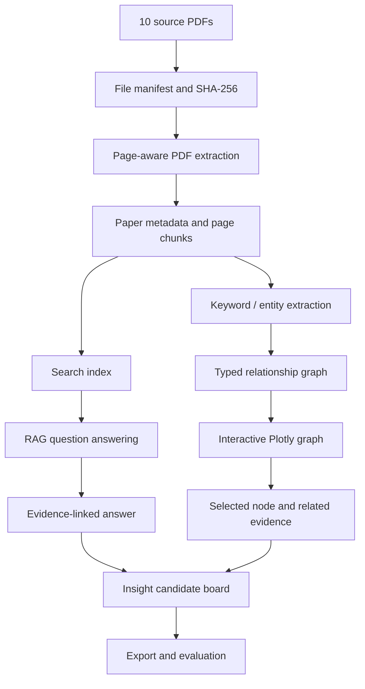

# PRD — Paper Digest MVP

- Status: Draft
- Product: `bonsai/paper-digest`
- Related: [MRD](mrd-paper-explorer.md)
- Target corpus: user-provided 10 PDFs
- Initial research focus: AI-generated anime/video production
- Runtime priority: Kaggle / local Python, free and reproducible

## 1. Product definition

PDF 10本をソースとして取り込み、ページ出典を保ったデータセットを生成する。ユーザーは動的グラフで関係を探索し、RAGで質問し、根拠付きのインサイト候補を記録できる。

## 2. MVP architecture

### Stack

- Python
- PyMuPDF for PDF text extraction
- pandas and NumPy for corpus analysis
- Plotly for interactive graph and charts
- SQLite FTS5 as a free lexical retrieval baseline
- Optional local/open model for answer synthesis; retrieval must remain useful without a generation model
- Kaggle Notebook as a reproducible entry point

Avoid making a paid API, dedicated GPU, or always-on service mandatory.

## 3. User stories and acceptance criteria

### US-01 — Register and audit source PDFs

As a researcher, I want to confirm which PDFs were loaded and whether each was processed correctly.

Acceptance:
- Recursively discover PDFs in a configured input folder.
- Generate a stable content-based paper ID and SHA-256 hash.
- Record file name, bytes, page count, pages with text, extraction status, and error details.
- Distinguish at least `success`, `no_text_layer`, `empty_pdf`, and `error`.
- One corrupt PDF must not abort processing of the remaining files.
- Do not claim all 10 are successfully processed if any failed.

### US-02 — Preserve page-level provenance

As a researcher, I want every search result and answer to point back to its source.

Acceptance:
- Each chunk has `chunk_id`, `paper_id`, `file_name`, `page_start`, `page_end`, `text`, `source_sha256`, and `extraction_method`.
- Initial chunking is one non-empty page per chunk; later versions may split long pages but must retain page provenance.
- Export `papers.csv`, `chunks.jsonl`, and `run-manifest.json`.
- Record extraction errors and library versions.

### US-03 — Compare papers in a structured view

As a researcher, I want to compare research goals, methods, datasets, metrics, findings, and limitations.

Acceptance:
- Provide a paper table with title (if extracted or manually supplied), year (if known), domain, method, dataset, metrics, and limitations.
- Unknown values remain explicitly unknown; do not infer bibliographic facts without evidence.
- Every extracted field can be reviewed against source pages.
- Domain labels include `live_action`, `anime_2d`, `animation_3d_cg`, `mixed`, and `unknown`. Domain classification is descriptive, not a quality score.

### US-04 — Explore a dynamic relationship graph

As a researcher, I want to select a graph node and discover connected papers and evidence.

Acceptance:
- Render an interactive Plotly graph.
- Node types include paper, keyword/concept, dataset, method, and evaluation metric.
- Edge types are explicitly typed: `co_occurrence`, `citation`, `semantic_similarity`, `uses_dataset`, `uses_metric`, and `uses_method`.
- Provide filters for node type, edge type, and paper/domain.
- Selecting a node shows connected nodes, related papers, and page-level evidence where available.
- Edge weight and method of calculation are documented.
- The UI warns that co-occurrence or graph proximity does not prove causality or importance.
- With no corpus data, show an empty state rather than a fabricated graph.

### US-05 — Ask questions using RAG

As a researcher, I want to ask questions about the 10 PDFs and receive evidence-backed answers.

Acceptance:
- Use a retrieval pipeline over page-aware chunks; SQLite FTS5 is the baseline.
- The retrieval result records chunk IDs and relevance scores.
- Answer synthesis can be disabled; search results must still work.
- Each factual answer claim is accompanied by citations containing paper name, page, chunk ID, and a short source excerpt.
- Clicking a citation navigates to the corresponding source record; if the original PDF is available in the session, provide a way to open it at the relevant page when technically possible.
- If evidence is missing or weak, state that the current corpus cannot establish the answer.
- Do not silently answer from general model knowledge as though it came from the PDFs.
- Distinguish paper-authored claims from system interpretation.
- Prevent source text from being treated as executable instructions; source text is untrusted evidence, not system instructions.

### US-06 — Discover and curate insight candidates

As a researcher, I want the system to propose patterns without pretending that hypotheses are proven.

Candidate categories:
- Commonality across papers
- Contradiction or disagreement
- Method/dataset/metric association
- Coverage gap within the current corpus
- Potential next experiment or research question

Each insight record contains:
- `insight_id`
- `claim`
- `category`
- `supporting_citations[]`
- `counterevidence[]`
- `interpretation`
- `confidence` (qualitative with rationale, not a calibrated probability unless calibrated)
- `limitations`
- `next_question`
- `review_status` (`unreviewed`, `accepted_for_followup`, `rejected`, `needs_more_evidence`)

Acceptance:
- Every candidate must link to at least one source chunk; cross-paper claims should cite multiple papers where available.
- The system labels candidates as hypotheses until a human reviews them.
- Include a way to record counterevidence and reject weak candidates.
- Do not claim a gap exists in the entire field solely because the 10-paper corpus does not cover it.

### US-07 — Reproduce and export

Acceptance:
- Save run timestamp, input hashes, dependency versions, extraction status, and configuration.
- Export the paper table, chunks, graph edges, citations, and insight board to CSV/JSONL.
- Allow exporting the interactive graph as HTML when supported by the environment.
- Document how to rerun the notebook.
- Do not commit restricted PDFs or extracted full text without checking their license.

## 4. Data contracts

### papers.csv

Required fields:
- `paper_id`
- `file_name`
- `sha256`
- `file_bytes`
- `page_count`
- `pages_with_text`
- `extraction_status`
- `error`

Recommended enrichment fields:
- `title`
- `authors`
- `year`
- `domain`
- `research_question`
- `method`
- `datasets`
- `metrics`
- `limitations`
- `metadata_source`
- `metadata_review_status`

### chunks.jsonl

Required fields:
- `chunk_id`
- `paper_id`
- `file_name`
- `page_start`
- `page_end`
- `text`
- `text_chars`
- `source_sha256`
- `extraction_method`

### keyword_edges.csv

Required fields:
- `source_id`
- `target_id`
- `edge_type`
- `weight`
- `weight_method`
- `supporting_paper_ids`
- `supporting_chunk_ids`

### insights.jsonl

Use the US-06 schema. Keep source citations as structured fields rather than embedding them only in prose.

## 5. Notebook layout

1. `00 Setup & Input` — dependency versions, PDF folder, configuration
2. `01 Corpus QA` — manifest, hashes, extraction states
3. `02 Page-aware Chunks` — sample and inspect extracted text
4. `03 Paper Comparison` — structured metadata table and unknowns
5. `04 Dynamic Keyword Space` — Plotly nodes, typed edges, filters
6. `05 Ask the Papers` — retrieval, evidence, answer/no-answer behavior
7. `06 Insight Board` — candidate patterns, counterevidence, review state
8. `07 Evaluation & Export` — fixed questions, metrics, reproducibility manifest

## 6. Evaluation protocol

Create a small, fixed question set before tuning retrieval:
- Questions answerable by one paper
- Cross-paper comparison questions
- Questions whose answer is not in the corpus
- Questions about method, dataset, metric, and limitations
- At least a few questions where the source wording is ambiguous

Evaluate:
- Citation correctness: does the cited page actually support the claim?
- Retrieval recall at k on manually labeled relevant chunks
- Answer faithfulness to retrieved evidence
- Appropriate abstention when evidence is absent
- Navigation from graph node to relevant paper/chunk
- Human review outcome for proposed insights

Report sample size and limitations. Do not present small-sample scores as broad guarantees.

## 7. Implementation phases

### Phase 1 — Source ingest and QA
- Confirm the 10 PDFs and permitted usage.
- Run `scripts/literature/ingest_pdfs.py`.
- Inspect text quality, especially tables, equations, and multi-column pages.
- Add a clear OCR-needed status; OCR itself can be a later phase.

### Phase 2 — Structured paper and chunk data
- Validate schemas and stable identifiers.
- Add metadata manually or with assisted extraction plus human verification.
- Build SQLite FTS5 index and search interface.

### Phase 3 — Graph and visualization
- Extract candidate keywords/entities with traceable provenance.
- Generate typed edges with documented methods.
- Render Plotly graph and node detail panel.
- Verify empty states and graph-to-source navigation.

### Phase 4 — RAG and citations
- Retrieve chunks from SQLite FTS5.
- Add optional reranking or semantic retrieval only after baseline evaluation.
- Generate answers from retrieved evidence only, with citations and abstention.
- Manually audit the fixed question set.

### Phase 5 — Insight review and export
- Generate candidate commonalities, disagreements, and corpus gaps.
- Attach supporting and counterevidence.
- Add human review states and export formats.
- Record reproducibility metadata.

## 8. Error handling and security

- Missing input directory: actionable error; do not create an empty success report.
- No PDFs: report zero files and stop analysis with an explicit empty state.
- Corrupt/locked PDF: record per-file failure and continue.
- Scanned PDF: mark OCR-needed/no text layer; do not fabricate text.
- Prompt injection in source documents: treat as quoted source content, never as instructions.
- Privacy/licensing: do not upload private or restricted papers to third-party services without authorization.
- Large files: process sequentially and avoid loading all raw PDF bytes into memory.

## 9. MVP definition of done

- Ten source files are accounted for in the manifest.
- Each file has an honest extraction status.
- Search results and chunks preserve source-page provenance.
- Dynamic graph has typed edges and links to relevant evidence.
- RAG can answer from retrieved chunks with citations and abstain when unsupported.
- Insight candidates include counterevidence/limitations and human review state.
- The notebook runs from a clean environment using documented steps.
- Evaluation results are based on actual test runs and clearly labeled as such.

## 10. Open decisions

- Exact ten PDFs and their usage rights
- How source PDFs are supplied to Kaggle
- Metadata enrichment strategy
- Local/hosted generation model choice
- Whether graph export should be a standalone HTML artifact in the MVP
- OCR and semantic retrieval priority after the lexical baseline
